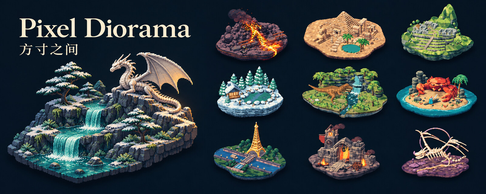
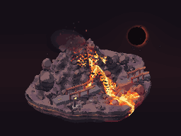
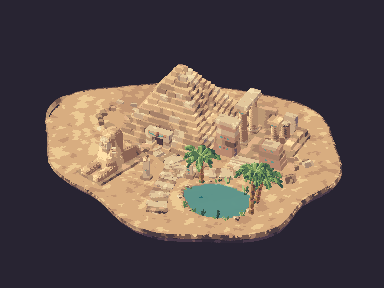
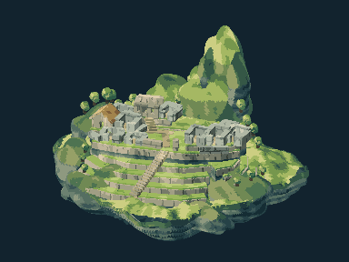
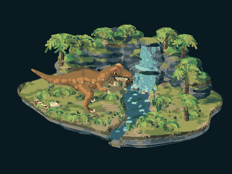
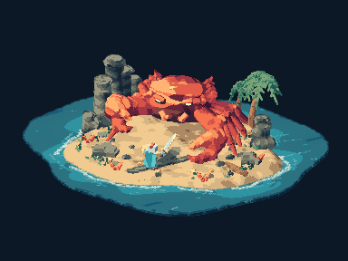
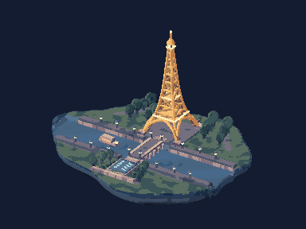
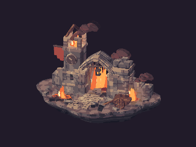

# Pixel Diorama

**用一句话，做出能旋转、能动起来的 3D 像素小世界。**

从雪松间升起的泉雾，到恐龙低头饮水时散开的涟漪。Pixel Diorama 是一套创作 3D 像素微缩场景的 Agent Skill，包含配方、JavaScript 生成器和播放器。成品可以导出为单个 HTML，保存后直接在浏览器里打开。

[下载完整包](https://github.com/Zyl857857/pixel-diorama/releases/latest) · [看 37 秒宣传片《方寸之间》](media/pixel-diorama-nine-worlds.mp4) · [浏览作品集文件](showcase/) · [查看 Skill](pixel-diorama/SKILL.md)

## 九个微缩世界

点击图片可看大图。下载完整包后，打开 `showcase/index.html` 进入离线作品集。

<table>
  <tr>
    <td width="33%" valign="top"> <strong>余烬火山</strong> 熔岩沿岩坡流下，灰烬在烟柱旁飘散。 <a href="showcase/emberfall-volcano.html">HTML</a> · <a href="examples/emberfall-volcano/scene.json">配方</a></td>
    <td width="33%" valign="top"> <strong>金字塔遗迹</strong> 沙丘之间露出石阶、狮身人面像和一小片绿洲。 <a href="showcase/pyramid-ruins.html">HTML</a> · <a href="examples/pyramid-ruins/scene.json">配方</a></td>
    <td width="33%" valign="top"> <strong>马丘比丘</strong> 梯田沿山脊层层展开，薄雾掠过石墙。 <a href="showcase/machu-picchu.html">HTML</a> · <a href="examples/machu-picchu/scene.json">配方</a></td>
  </tr>
  <tr>
    <td valign="top"> <strong>雪松温泉</strong> 从雪地走到冒着热气的泉边。 <a href="showcase/cedar-spring-explore.html">HTML</a> · <a href="examples/cedar-spring-explore/scene.json">配方</a></td>
    <td valign="top"> <strong>侏罗纪河谷</strong> 异特龙俯身饮水，瀑布和水面各有不同的动势。 <a href="showcase/dinosaur-valley.html">HTML</a> · <a href="examples/dinosaur-valley/scene.json">配方</a></td>
    <td valign="top"> <strong>断潮岛</strong> 巨蟹张开双钳，持剑的勇士站在浪头前。 <a href="showcase/crab-island.html">HTML</a> · <a href="examples/crab-island/scene.json">配方</a></td>
  </tr>
  <tr>
    <td valign="top"> <strong>巴黎夜色</strong> 铁塔亮起，暖光落在蓝色的塞纳河畔。 <a href="showcase/eiffel-paris.html">HTML</a> · <a href="examples/eiffel-paris/scene.json">配方</a></td>
    <td valign="top"> <strong>灰钟关</strong> 跟着提灯守关人，走过火光照亮的拱门。 <a href="showcase/ash-gate.html">HTML</a> · <a href="examples/ash-gate/scene.json">配方</a></td>
    <td valign="top"> <strong>骨龙苏醒</strong> 从头颈到翼尖，骨架逐节抬起。 <a href="showcase/bone-dragon-awakens.html">HTML</a> · <a href="examples/bone-dragon-awakens/scene.json">配方</a></td>
  </tr>
</table>

## 怎么开始

| 想做什么 | 从这里开始 |
| --- | --- |
| **直接体验** | 下载并解压完整包，打开 `showcase/index.html`。完整的 3D 交互使用支持 WebGL 2 的浏览器。 |
| **让 Agent 创作新场景** | 导入 `pixel-diorama/` 整个目录，保留 `SKILL.md`、`assets/`、`scripts/` 和 `references/`。在本地 Codex 中，可把该目录放到目标项目的 `.agents/skills/pixel-diorama/`。 [Codex Skills 文档](https://learn.chatgpt.com/docs/build-skills) |
| **在本地改配方** | 安装 Node.js 18 或更新版本，然后用下面的命令生成 HTML 和预览图。 |

打开场景后，拖动可转动视角，滚轮可缩放。带探索模式的作品可以点击「开始探索」，用 **WASD** 或方向键移动。动态作品也可以暂停，近看骨龙展翼或流水的细节。

## 三个可以直接试的提示词

**做一个能近看的风景**

> 做一个雨后的山谷，冷青色的雾贴着山坡走，瀑布分两级落进浅潭。让镜头拖近后还能看清岩缝、湿苔和水花。交付可旋转的离线 HTML。

**让一个动作讲清楚故事**

> 做一座被海浪围住的小岛。巨蟹先抬起一只钳子，停一下再合钳。海浪保持流动，让勇士和巨蟹的大小反差一眼可见。

**走进场景**

> 做一个深夜还亮着灯的雪松温泉。给我一个提灯小人，从石阶入口走到木屋，再沿泉边走一圈。用脚印和木桥提示路线。

## 从源码构建

生成器只用 Node.js 标准库。在仓库根目录执行。

~~~sh
# 用自带配方构建一个场景
node pixel-diorama/scripts/build.js pixel-diorama/assets/recipes/cedar-spring.json build/cedar-spring.html --review

# 重建一个展品，或重建全部九个展品
node examples/build.cjs dinosaur-valley build/showcase
node examples/build.cjs --all build/showcase

# 检查水位、角色碰撞和动画循环
node pixel-diorama/scripts/check.js
~~~

`--review` 会随 HTML 生成正面与侧面的实渲染图，以及可用于检查物件位置的布局 JSON。可以先调配方里的镜头和光色，再加流水、雾气或角色动作。

## 项目结构

| 路径 | 内容 |
| --- | --- |
| [pixel-diorama/](pixel-diorama/) | 可导入的 Skill、通用生成器、离线播放器与素材 |
| [examples/](examples/) | 九个展品的配方和场景专用渲染源码 |
| [showcase/](showcase/) | 离线作品集、可直接打开的 HTML 和实渲染预览 |
| [media/](media/) | 1080p 宣传片《方寸之间》 |

配方与创作参考可单独查看。[配方字段](pixel-diorama/references/recipe.md) · [造型与光色](pixel-diorama/references/art-direction.md) · [主体动画](pixel-diorama/references/motion.md) · [可游玩的场景](pixel-diorama/references/explore.md)
