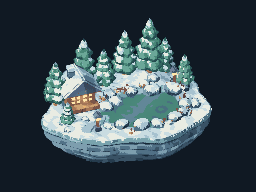
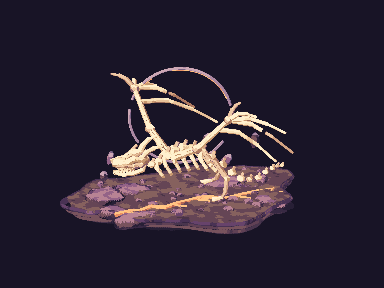

# Pixel Diorama · 方寸之间

这里收着九个用 JavaScript 搭出来的 3D 像素场景，以及生成它们的工具。每个场景都是一个可以离线打开的 HTML 文件，拖动转视角，滚轮拉近。

[下载当前版本](https://github.com/Zyl857857/pixel-diorama/archive/refs/heads/main.zip) · [正式发布包](https://github.com/Zyl857857/pixel-diorama/releases/latest) · [看短片](media/pixel-diorama-nine-worlds.mp4) · [安装 Skill](#安装-skill)

## 先玩这三个

下载并解压后，打开 `showcase/index.html`。作品集里可以按「角色探索」「生物动作」「地形与建筑」筛选。

<table>
  <tr>
    <td width="33%" valign="top"> <strong>侏罗纪河谷</strong> 拖进度条，停在异特龙的嘴刚碰到水面时。 <a href="showcase/dinosaur-valley.html">HTML</a> · <a href="examples/dinosaur-valley/compose.cjs">动作源码</a></td>
    <td width="33%" valign="top"> <strong>雪松温泉</strong> 点击「开始探索」，用 WASD 或方向键走到泉边。 <a href="showcase/cedar-spring-explore.html">HTML</a> · <a href="examples/cedar-spring-explore/scene.json">配方</a></td>
    <td width="33%" valign="top"> <strong>骨龙苏醒</strong> 转到侧面看，骨龙先抬颈，再把长翼展开。 <a href="showcase/bone-dragon-awakens.html">HTML</a> · <a href="examples/bone-dragon-awakens/scene.json">配方</a></td>
  </tr>
</table>

GitHub 上的 HTML 链接用来查看文件。想操作场景，就在本地浏览器打开下载后的 HTML。完整的 3D 交互需要 WebGL 2。

## 其余六个场景

| 场景 | 细节 | 文件 |
| --- | --- | --- |
| 余烬火山 | 熔岩、烟柱与岩坡上的木桥 | [HTML](showcase/emberfall-volcano.html) · [配方](examples/emberfall-volcano/scene.json) |
| 金字塔遗迹 | 石阶、狮身人面像与绿洲 | [HTML](showcase/pyramid-ruins.html) · [配方](examples/pyramid-ruins/scene.json) |
| 马丘比丘 | 梯田顺着山脊层层落下 | [HTML](showcase/machu-picchu.html) · [配方](examples/machu-picchu/scene.json) |
| 断潮岛 | 浅滩上的巨蟹与持剑勇士 | [HTML](showcase/crab-island.html) · [配方](examples/crab-island/scene.json) |
| 巴黎夜色 | 夜间的塞纳河两岸与亮灯的铁塔 | [HTML](showcase/eiffel-paris.html) · [配方](examples/eiffel-paris/scene.json) |
| 灰钟关 | 操控提灯守关人穿过拱门 | [HTML](showcase/ash-gate.html) · [配方](examples/ash-gate/scene.json) |

## 安装 Skill

要导入的是内层目录 [`pixel-diorama/`](pixel-diorama/)，也就是放着 `SKILL.md` 的那一层，不是仓库根目录，也不是 GitHub zip 解压后的最外层。把这个目录整个交给支持 Agent Skills 的客户端。本地 Codex 把它复制或软链接到目标项目的 `.agents/skills/pixel-diorama/`。[Codex Skills 文档](https://learn.chatgpt.com/docs/build-skills)

用 Codex 打开本仓库时，根目录的 `.agents/skills/pixel-diorama` 已软链接到这个内层目录，会自动发现 Skill。

导入之后，Skill 只带自己目录里的文件。起步用 `assets/recipes/` 里的配方和 `references/` 里的说明。`examples/` 和 `showcase/` 属于本仓库的完整 git 检出，导入后的包里没有；只有在这个检出里工作时才去打开。

试试直接描述你想看的画面。

> 做个雨后的山谷。瀑布落两级，一只恐龙站在浅滩喝水。它的嘴碰到水面时才起涟漪。给我可以拖动视角的离线 HTML。

## 改配方与重新生成

安装 Node.js 18 或更新版本。在仓库根目录执行下面任意一条。

~~~sh
# 从内置的温泉配方生成场景和两角度预览
node pixel-diorama/scripts/build.js pixel-diorama/assets/recipes/cedar-spring.json build/cedar-spring.html --review

# 重新生成一个展品，或全部九个
node examples/build.cjs dinosaur-valley build/showcase
node examples/build.cjs --all build/showcase

# 检查水位、探索碰撞和动画循环
node pixel-diorama/scripts/check.js
~~~

改镜头和颜色时，可以先从 [温泉配方](pixel-diorama/assets/recipes/cedar-spring.json) 开始。想做角色动作，再看 [生物动画](pixel-diorama/references/motion.md) 和 [异特龙的动作编排](examples/dinosaur-valley/compose.cjs)。

| 路径 | 内容 |
| --- | --- |
| [pixel-diorama/](pixel-diorama/) | Skill、生成器、播放器与[配方说明](pixel-diorama/references/recipe.md) |
| [examples/](examples/) | 九个展品的配方与渲染源码 |
| [showcase/](showcase/) | 展厅入口、离线 HTML 和预览图 |
| [media/](media/) | 短片《方寸之间》 |
